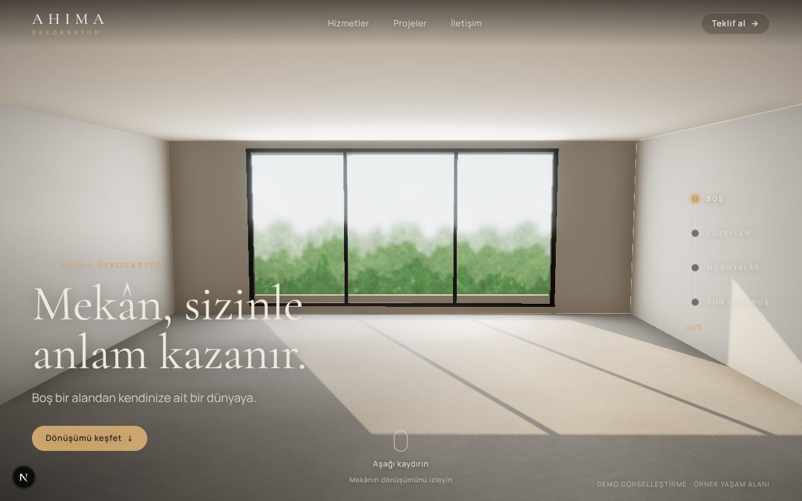
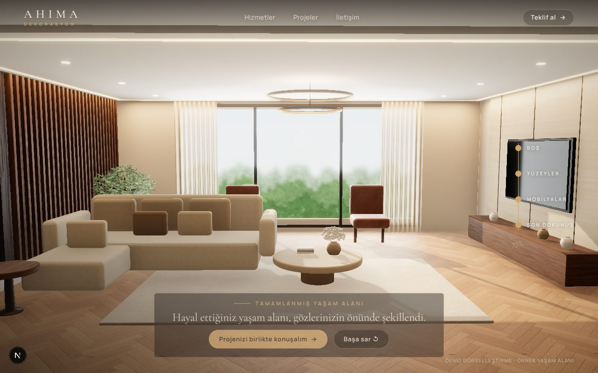
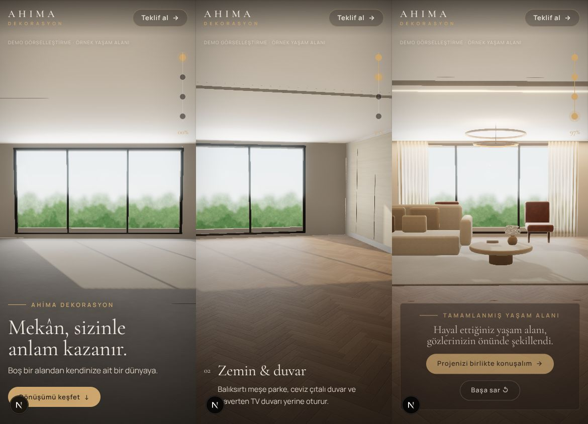

# Ahima Dekorasyon — 3D scroll salon demosu

Boş bir salon, kaydırdıkça **aynı odada** parke ve duvar kaplamaları, mobilyalar, tekstil, bitki ve aydınlatmayla
tamamlanır. Yukarı kaydırınca her şey aynı yoldan geri sarılır. Video, görsel slaytı ya da önceden hazırlanmış kare
kullanılmaz; her karede gerçek WebGL 3D sahne çizilir.

**Next.js 15 (App Router) · TypeScript · Three.js · React Three Fiber · Drei · @react-three/postprocessing · GSAP ScrollTrigger**

```bash
npm install
npm run dev                 # http://localhost:3000
npm run typecheck && npm run lint && npm run build
```

GitHub Pages (statik export): `PAGES_BASE_PATH=/erdemakkas1-ops/ahima-salon-3d npm run build` → `out/`.
Vercel'de ek ayara gerek yoktur (`next build`).

| Boş salon (ilk kare) | Tamamlanmış salon | Mobil |
|---|---|---|
|  |  |  |

## Hazırlık paketine nasıl uyuldu

Kaynak paket `paket/` klasöründe (talimatlar, docs, manifest, `build_room.py`, AI konsept görselleri). Proje kuralları
`CLAUDE.md`.

- Dört GLB (`public/models/00_shell … 03_details.glb`) **orijinde**, aynı koordinatta yüklenir. `00_shell` hep
  görünür; diğer üçündeki her adlandırılmış node ayrıştırılıp scroll ilerlemesine bağlanır.
- Tek GSAP ScrollTrigger + tek timeline, `story.p` (0–1) değerini scrub eder. Sahnedeki her nesnenin pozu, kamera,
  ışıklar ve HTML katmanı bu sayının **saf fonksiyonudur**. Sonuç: ileri/geri kaydırmada drift yok, hızlı ya da ters
  kaydırmada çakışma yok.
- Açılışta dolu oda (konsept görsel) **gösterilmez**; yükleme ekranı düz espresso renktir.
- Bina dışı, kat planı, başka odaya uçuş, video yok.

### Zaman çizelgesi (`components/scene/choreography.ts`)

| İlerleme | Aşama | Ne olur |
|---|---|---|
| 0.00–0.12 | Boş | Ham beton, sıva, pencereden düşen güneş |
| 0.12–0.38 | Yüzeyler | Balıksırtı meşe parke pencereden kameraya doğru döşenir; ceviz zemin paneli ve 27 çıta sırayla yerden yükselir; traverten TV duvarı ve derzleri; asma tavan iner |
| 0.34–0.79 | Mobilyalar | TV ünitesi → TV → L koltuk (tek parça, ~70 cm kayarak) → minderler → sehpa → yan sehpa → iki berjer |
| 0.72–0.94 | Son dokunuş | Halı açılır, bitki, kırlent, kitaplar, vazo, tül perdeler, sarkıt tavandan iner; gizli LED, spotlar ve sarkıt ışığı yanar |
| 0.94–1.00 | Final | Küçük kamera düzeltmesi, CTA |

Giriş türleri: kaplamalar **clipping plane** ile açılır (doku gerilmez), mobilyalar metrik kısa mesafeden yerine
oturur, LED'ler emissive + alan ışığı rampasıyla yanar. Kamera yolu `docs/SAHNE_VE_ANIMASYON.md`'deki
noktaları izler; masaüstünde çok hafif boşta salınım + fare paralaksı vardır.

## Görsel kalite iyileştirmeleri (GLB'lere göre)

GLB'ler renkli blockout'tur (köşeli kutular, ikosferler, düz renkler). Her node'un **son konumu ve ölçüsü korunarak**:

- Kutular pahlı (`RoundedBoxGeometry`) yapıldı; minder ve kırlentler şişirildi; sehpalar, vazolar, saksı lathe ile
  yeniden çizildi; sarkıt gerçek torus oldu.
- Bitki küreleri ~2.100 yapraklık zeytin dokusu + dallarla, çiçek küreleri ortanca kümeleriyle değiştirildi.
- Tüm yüzeylere PBR malzeme (renk + normal + pürüzlülük, dünya-uzayı UV): balıksırtı meşe (vernik clearcoat'lu),
  ceviz, traverten, bukle kumaş, keten, deri, halı, sıva, beton.
- Eklenenler (GLB'de yok, `extra:` adıyla işaretli): pencere camı, pencere dışı bahçe fonu, tül perdeler, tavan
  spotları, kamera tarafında devam eden zemin/tavan/duvar (kadrajda boşluk görünmesin diye).
- Işık: pencereden düşük açılı gölgeli güneş, pencere boşluğunda alan ışığı, lightformer ortam haritası (dış HDR
  indirmeden), 2700K LED alan ışıkları, sarkıt ışığı. Post-process: N8AO ambient occlusion, bloom, ACES tonemapping,
  vinyet, SMAA.

### Dokular

Bu ortamdan Poly Haven'a erişim engelli olduğu için dokular `scripts/make_textures.py` ile **prosedürel** üretildi
(gürültü tabanlı, kesintisiz döşenebilir, lisans sorunu yok). Yeniden üretmek için:

```bash
pip install numpy scipy pillow
npm run textures
```

Poly Haven (CC0) dokularıyla değiştirmek isterseniz aynı adlarla `public/textures/` içine koymanız yeterli
(`*_col.jpg`, `*_nrm.jpg` OpenGL normal, `*_rgh.jpg`). Önerilen sayfalar `paket/docs/MALZEME_KAYNAKLARI.md`'de.

## Mobil, erişilebilirlik, yedekler

- Dokunmatik / dar ekranda: DPR ≤ 1.5, 1024 gölge haritası, yarım çözünürlüklü AO; dikey ekranda daha geniş lens,
  kamera biraz geride ve o an inşa edilen bölgeye (sol duvar → TV duvarı → koltuk → merkez) yumuşak pan.
- `PerformanceMonitor` FPS düşerse DPR'ı kademeli azaltır. Hikâye ekran dışındayken render durur.
- `prefers-reduced-motion`: scrub yumuşatması ve kamera salınımı kapanır, hareket mesafeleri %25'e iner; dönüşüm yine
  kullanıcının kaydırmasıyla kontrol edilir.
- WebGL yoksa erişilebilir açıklama metni ve aşama listesi gösterilir.
- Sağdaki aşama göstergesi tıklanabilir; finalde "Başa sar" düğmesi var.

## Dürüstlük notları / sınırlar

- **Bu bir müşteri demosudur.** Logo (`AHIMA / DEKORASYON` kelime işareti), hizmet kapsamı, projeler ve iletişim
  bilgileri **yer tutucudur**; hiçbiri uydurulmadı. Kontrol listesi: `paket/docs/MUSTERI_ICERIK_KONTROL.md`.
- 3D sahne örnek bir yaşam alanıdır, gerçek bir Ahima projesi değildir. Sayfada "Demo görselleştirme" etiketi var.
- Gerçek zamanlı render fotogerçekçiliğe **yaklaşır** ama mimari görselleştirme (path-traced) kalitesinde değildir.
  En büyük kalite sıçraması için: lisansı uygun gerçek mobilya modelleri (koltuk, berjer, bitki) ve fotoğraf tabanlı
  PBR dokular. Sahne ölçüleri ve node adları değişmeden bu modeller aynı aktör yapısına takılabilir.
- Performans yalnızca headless (yazılımsal WebGL) tarayıcıda doğrulandı; gerçek cihazlarda FPS ölçümü yapılmalı
  (hedef: masaüstü 60, mobil 30 — garanti değil).

## Klasör yapısı

```
app/                    layout (fontlar, metadata), sayfa, global CSS
components/Experience   ScrollTrigger + sticky canvas + WebGL yedeği
components/Overlay      başlık, aşama açıklamaları, ilerleme göstergesi, final CTA (rAF ile, re-render yok)
components/scene/       SceneCanvas · Room (GLB → aktörler) · choreography · geometry · materials · Lights · CameraRig
components/sections/    Hizmetler / Projeler / İletişim / Footer (yer tutucular)
lib/story.ts            ilerleme deposu, aşamalar, easing
public/models           4 GLB (paketten, değiştirilmeden)
public/textures         prosedürel PBR dokular
scripts/make_textures.py
paket/                  hazırlık paketi (talimatlar, docs, konseptler)
docs/onizleme           test ekran görüntüleri
```

Ekran görüntüsü testleri için `?shot` parametresi GSAP lag smoothing'i kapatır (yazılımsal WebGL ~1 fps çalıştığında
scrub'ın gerçek zamanda ilerlemesi için); normal kullanımda etkisi yoktur.
